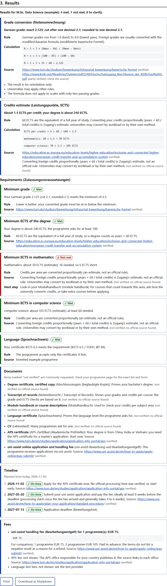

**English** | [简体中文](README.zh-CN.md)

# Zugang

**A free, offline self-check that tells international applicants whether they meet a German master's programme's requirements, and shows the rule, the calculation and the source behind every answer, in English and Simplified Chinese.**

*Zugang* means "access", as in *Hochschulzugang*, access to higher education.

Built for AccessED Hacks 2026. Main track: **Afford**. Also serves **Understand**.



## The barrier, and who it is for

Applying to a German master's programme from abroad means working through rules spread over many official pages, mostly in German: grade conversion to the German scale, minimum credits per subject area counted in ECTS, an APS certificate for degrees from China, India or Vietnam, and uni-assist fees and deadlines. Many applicants pay agencies to do this for them, or pay uni-assist fees for programmes they were never eligible for.

Zugang is for international students preparing to apply, especially from China, India and Vietnam, and for anyone helping them. It removes two barriers:

- **Cost**: no agency needed for the first check, and no uni-assist fee spent on a programme you do not qualify for.
- **Language**: German admission terms are explained in plain English and Chinese, with the German word kept next to the translation, for example "Bewerbungsfrist (application deadline)".

## Before and after: Lin (an invented example applicant)

Lin has a 4-year bachelor's degree from China: 100-point scale, lowest pass 60, average 85, 160 credits, 20 of them in mathematics and 70 in computer science, IELTS 6.5. Target: the example programme "M.Sc. Data Science" (minimum grade 2.5, at least 36 ECTS in mathematics, via uni-assist, deadline 2027-07-15).

- **Before**: Lin pays an agency, or reads a dozen German pages and still is not sure.
- **After**: one page, each number explained and sourced. These are the values the code produces; `tests/check.test.js` and `tests/data.test.js` assert them:
  - German grade **2.125** (1 + 3 × (100 − 85) / (100 − 60)), which meets 2.5.
  - **1.5** ECTS per credit (4 × 60 / 160), so mathematics comes to **30 ECTS, 6 short of 36**.
  - **APS certificate needed**: start now.
  - uni-assist documents and payment by **2027-05-20** (8 weeks before the deadline).
  - uni-assist fee **EUR 75** for one programme, **EUR 105** for two.

## Features

- Profile form with three invented example applicants (Lin, Priya, Minh), each exercising a different path.
- Grade conversion with the modified Bavarian formula, steps shown, with exact, cut and rounded values (no official rounding rule was found, so both are shown).
- ECTS estimate per subject area, clearly labelled as an estimate.
- Requirement check against one of three invented example programmes, or requirements you type in. A missing value gives "ask the admissions office", never a guess.
- Document checklist, back-planned timeline and official fees.
- Glossary of 27 German admission terms (DE, EN, ZH) with plain explanations.
- Every result links its source and shows whether that source is verified, partly verified or not verified.
- English and Simplified Chinese; the choice is remembered on your device.
- Print stylesheet and "Download as Markdown".
- No account, no server, no tracking, no network calls: nothing you type leaves the browser.

## How to run

Requirements: a browser and Python 3 (only to serve the files; Chrome does not load ES modules from `file://`).

```sh
git clone https://github.com/hoongyu/zugang.git
cd zugang
python3 -m http.server 8000
```

Open http://localhost:8000/ . Add `?example=lin`, `?example=priya` or `?example=minh` to open straight on an example's results.

Tests (Node 18 or later, no dependencies):

```sh
node --test
```

### Deploying to GitHub Pages (for the owner)

1. Make the repository public when ready (Settings, General, Danger Zone).
2. Settings, Pages: Source "Deploy from a branch", branch `main` (after merging `mvp`) or `mvp`, folder `/ (root)`.
3. The site appears at `https://hoongyu.github.io/zugang/`. All paths are relative, so no build step is needed.

## Accessibility

Semantic HTML with one `h1` and numbered `h2` sections; a label for every field; fieldsets with legends; logical tab order and a skip link; visible 3 px focus outline; results announced through an `aria-live` region and focus moved to the results heading; status shown as icon plus text, never by colour alone; `lang` attributes on Chinese and German text; works at 390 px width and at 200% zoom without horizontal scrolling; respects `prefers-reduced-motion`. The lowest text contrast measured on the rendered page was 7.0:1. Details and how each item was checked: [docs/build-log.md](docs/build-log.md).

## Data and sources

All applicants and programmes are invented and labelled as examples. The rules come from `data/rules.json`; each has a source and a verification flag. The owner checked these sources on 2026-11-02. In the build session the source sites were blocked by the network policy, so no fact could be re-checked, and every fact the owner had marked true is shown as **partly verified** until it is re-checked.

| Fact | Source | Status in the app |
|---|---|---|
| Modified Bavarian formula; result is orientation only | [TUM](https://www.tum.de/studium/bewerbung/infoportal-bewerbung/bayerische-formel), [Universität Hamburg](https://www.uni-hamburg.de/campuscenter/bewerbung/international/studium-mit-abschluss/anerkennung-auslaendischer-schulbildung/notenumrechner.html) | partial |
| Formula does not apply to scales with only two passing grades (one university's statement) | [Universität Marburg](https://www.uni-marburg.de/de/fb02/studium/pruefungsbuero/anerkennungen/notenumrechnung-grade-conversion) | partial |
| No official rule on cutting or rounding the converted grade | none | false: both values shown |
| APS certificate needed for degrees from China, Vietnam, India | [TUM APS page](https://www.tum.de/en/studies/application/aps) | partial |
| APS fees | sources disagree | false: no amount shown |
| uni-assist fee: EUR 75 first programme, EUR 30 each additional | [uni-assist](https://uni-assist.de/en/how-to-apply/pay-all-fees/handling-fees) | partial |
| uni-assist: submit and pay 8 weeks before the deadline; 4 to 6 weeks processing | [uni-assist](https://uni-assist.de/en/how-to-apply/plan-your-application/deadlines-processing-time) | partial |
| 60 ECTS = one year of full-time study | ECTS Users' Guide 2015 (URL not yet verified) | partial |
| Proportional credit conversion | Zugang's own estimate | false: labelled as an estimate |

## Limitations

- Rules differ by university and programme. Always check the official page of your programme.
- The grade formula gives orientation only; universities may apply other rules (for example the ZAB's).
- The ECTS conversion is an estimate; universities may convert by workload or their own method.
- APS and language-test fees are not shown, because sources disagree.
- Some facts are only partly verified (see above).
- Not legal advice. Not affiliated with uni-assist, DAAD, APS or any university.

## Authorship, AI assistance and prior work

- The owner, a master's student at TU Berlin, chose the problem, wrote the design together with Claude and reviews the build.
- Claude Code (Anthropic) wrote the code and the docs in one cloud session on 2026-11-02, following [the design](docs/superpowers/specs/2026-11-02-zugang-design.md) and [the task](docs/cloud-task.md).
- Prior work: none. The repository was created on 2026-11-02, inside the AccessED development period (2026-10-17 to 2026-11-20). The design was written a few hours before the code. There is no earlier code.
- Libraries: none. Fonts: system fonts. Data: synthetic, plus public rules cited above.

## Licence

MIT, see [LICENSE](LICENSE).
